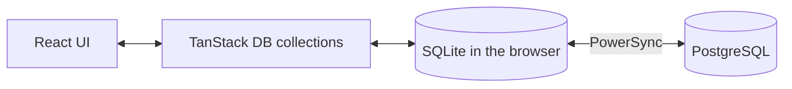

# Oriel

[](LICENSE)

Author: **Ákos Kappel**

One calm place for the everyday things you don't want to forget: notes, shopping lists, tasks and quick thoughts, alone or shared with the people you live with. Built mobile-first and offline-first, so it opens instantly and keeps working without a connection.

**Status:** early development. Quick capture works and notes, lists and tasks are stored in a local SQLite database in the browser; editing and organization come next, then sign-in and sync.

## Principles

- **Fast capture:** adding something takes seconds, without forms.
- **Offline-first:** data lives on the device first and syncs when a connection is available.
- **Live collaboration:** shared lists update on every member's device.
- **Private by default:** you see only what you own or what was shared with you.

## Quick capture

The capture field sits at the bottom of the screen. Pick Note, List or Task, type, and press Enter; Shift+Enter starts a new line, and `/` focuses the field on desktop.

- The first line is the title. Further lines become the note body, the task details or the list entries (bullets and `[ ]` are removed).
- A list fits on one line: `Groceries: milk, eggs, bread`.
- A long pasted paragraph becomes a note with a short title and the full text kept.

## Tech stack

- [TanStack Start](https://tanstack.com/start) (React 19, file-based routing) on Vite and Nitro
- TypeScript
- Tailwind CSS v4 with shadcn/ui primitives and Lucide icons
- [TanStack DB](https://tanstack.com/db) for reactive client collections and optimistic writes
- [PowerSync](https://www.powersync.com) Web SDK with SQLite (WASM) as the local database
- Zod for validation
- Planned: PostgreSQL as the server database, synced through PowerSync
- Biome, Vitest, GitHub Actions

## How it works



The UI only talks to local data. PowerSync uploads local changes when the device is online and streams changes from other devices back. The server decides who may see and change what.

## Getting started

Requires Node.js 24.

```bash
npm install
npm run dev
```

The app runs at http://localhost:3000.

## Scripts

| Command             | What it does                         |
| ------------------- | ------------------------------------ |
| `npm run dev`       | Start the dev server                 |
| `npm run build`     | Build for production into `.output/` |
| `npm start`         | Run the production build             |
| `npm run check`     | Lint and format check (Biome)        |
| `npm run check:fix` | Fix lint and formatting              |
| `npm run typecheck` | Type-check the project               |
| `npm test`          | Run the unit tests                   |

## License

[MIT](LICENSE)
