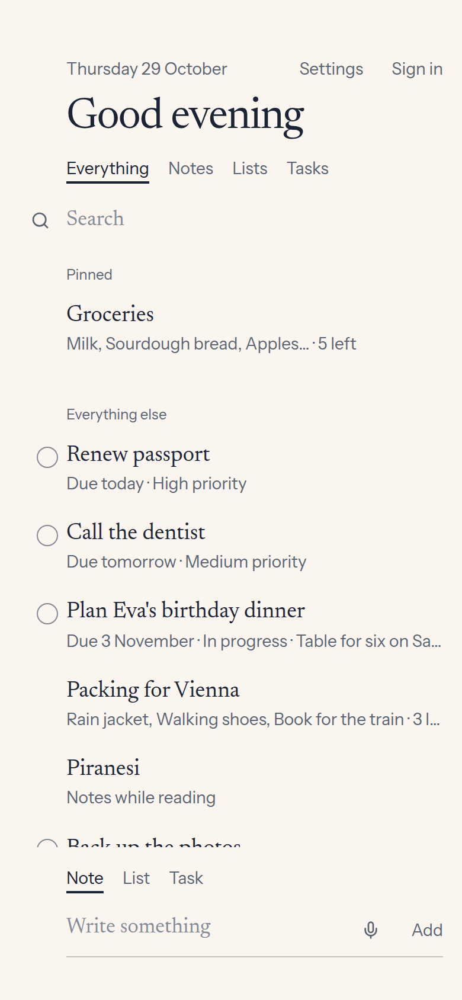
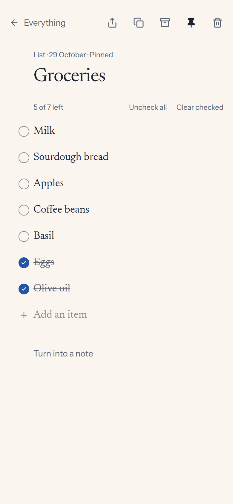
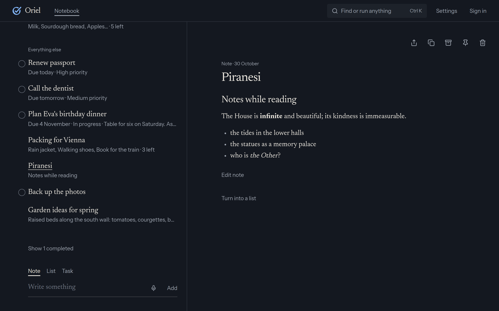
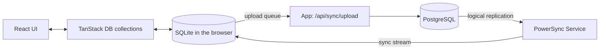

# Oriel

[](https://github.com/AkosKappel/oriel/actions/workflows/ci.yml)
[](LICENSE)

Author: **Ákos Kappel**

One calm place for the everyday things you don't want to forget: notes, shopping lists, tasks and quick thoughts, alone or shared with the people you live with. Built mobile-first and offline-first, so it opens instantly and keeps working without a connection.

**Status:** in active development, self-hosted on a home server. Notes, lists and tasks work fully offline in a local SQLite database, and the app installs as a PWA. An optional account adds sync between devices and spaces shared with others.

<p>
  
  
</p>



The public site at `/` (home, about, FAQ, privacy, terms, accessibility) introduces the app; the notebook itself lives at `/app`, which is also where the installed app opens.

## Principles

- **Fast capture:** adding something takes seconds, without forms.
- **Offline-first:** data lives on the device first and syncs when a connection is available.
- **Live collaboration:** shared lists update on every member's device.
- **Private by default:** you see only what you own or what was shared with you.

## Quick capture

The capture field sits at the bottom of the screen. Pick Note, List or Task, type, and press Enter; Shift+Enter starts a new line, and `/` focuses the field on desktop.

- The first line is the title. Further lines become the note body, the task details or the list entries (bullets and `[ ]` are removed).
- A list fits on one line: `Groceries: milk, eggs, bread`.
- A long pasted paragraph becomes a note with a short title and the full text kept.
- Where the browser supports speech recognition (Chrome, Safari), the microphone button dictates into the field. The browser's speech service needs a connection, so it is off while offline.

## Organizing

- **Home:** pinned items first, then open items by priority and date, completed tasks folded away. Filter by notes, lists or tasks, and tasks by due day (today, overdue included, or upcoming) or status, or the tasks given to you in shared spaces ("For me"); the filters are part of the URL.
- **Search:** finds every word typed in titles, text and list entries, ignoring case and accents. It runs on the device, so it works offline.
- **Detail:** edit the title and text (saved as you type; notes are Markdown, shown formatted and edited as text), complete tasks, set a priority (none, low, medium, high), a status (to do, in progress, waiting) a due day (open tasks with one come first, labelled "Due today" or "Overdue since") and a repeat (daily, weekly or monthly: checking such a task off moves it to its next due day), pin, duplicate (a list comes back unchecked, to reuse it as a template), snooze (off home until tomorrow, next Monday or a month on, then back near the top; listed under Snoozed), archive, or move to the trash with Undo. Escape closes it, and j and k move to the next and previous item. Ctrl+K (⌘K) opens a command palette: type part of any note, list or task to jump to it, or run a command (new item, filters, archive, settings).
- **Archive and trash:** archived items leave home but stay searchable in the archive. Deleted items wait in the trash for 30 days, on every device, and can be restored by anyone who can edit the space; after that a device deletes them for good. In a shared space the trash names who deleted something.
- **Swipes:** on a phone, swipe a row right to finish a task (or archive a note or list) and left to move it to the trash, with Undo. Checking something gives a short vibration on Android.
- **Wide screens:** the list stays on the left and the open item reads beside it; on a phone they are separate screens.
- **Lists:** check, rename, remove (or empty the text) and add entries; drag an entry by its handle, or use the arrow keys on it, to change the order; pasting several lines adds one entry per line, and entries used in earlier lists are suggested while typing. Checked entries move to the bottom; "Clear checked" removes them and "Uncheck all" resets a list for reuse, both with Undo.
- **Settings:** theme (like the device, light or dark), storage used, export of everything as JSON or Markdown, open tasks with a due day as a calendar file (.ics), and import of a JSON export (into your own space, skipping what is already there).

## Offline and installable

- A service worker (`scripts/service-worker.js`, emitted as `sw.js` with the build) precaches the app, so it opens and works with no connection after the first visit. New versions are offered with a Reload button, never forced mid-edit.
- Installable as a PWA, with shortcuts for a new note, list or task, and a share target: sharing a link or text from another app on Android creates a note.
- The browser is asked to keep the database (persistent storage) after the first save.
- The installed app shows the number of open tasks on its icon (Badging API, where supported).

## Accounts

No account is needed: everything works on the device. Creating an account (email and password, with Better Auth) gives you a personal space on the server, and everything you made before signing up moves into it, so nothing is lost. Signing out removes the data from the device, so the next person to use it starts clean. A forgotten password is reset with a single-use link sent by email, which signs out every device. The account page changes the name (shared spaces show the new one) and the password (other devices are signed out), and lists the signed-in devices, each of which can be signed out from there.

Deleting the account (with the password) removes it, the personal space and every shared space nobody else uses, on the server and on the device. A shared space others still use must get another owner first, so it is never left without one.

## Sharing

- **Spaces:** your personal space is only yours. Create a shared space (a household, a trip), invite people, and move notes and lists into it. Members see changes from each other within a second.
- **Invites:** an owner creates a link that one person can use within 7 days; only a hash of it is stored. With an email address, Oriel also sends the link (through Resend; without `RESEND_API_KEY` the email is printed in the server output during development). Someone without an account is asked to create one when opening it, and anything already on their device comes along.
- **Roles:** owners manage the space and its members, editors change content, viewers only read (their screens are read-only, and the server refuses their writes). A space always keeps an owner.
- **Who did what:** items another member added show "by Anna", and checked entries and done tasks show who checked them.
- **Leaving:** removing someone, or leaving, takes the space off their devices on the next sync. An owner can leave while another owner stays; the last owner deletes the space instead.

## Tech stack

- [TanStack Start](https://tanstack.com/start) (React 19, file-based routing) on Vite and Nitro
- TypeScript
- React Aria Components for accessible controls, Tailwind CSS v4, Newsreader and Instrument Sans (self-hosted), Lucide icons
- [TanStack DB](https://tanstack.com/db) for reactive client collections and optimistic writes
- [PowerSync](https://www.powersync.com) Web SDK with SQLite (WASM) as the local database
- Zod for validation
- PostgreSQL 18 with Drizzle ORM, Better Auth for accounts
- Planned: syncing the local database with PostgreSQL through PowerSync
- Biome, Vitest, GitHub Actions

## How it works



- **Reads** always come from the local SQLite database, so the app is instant and works offline.
- **Writes** land locally first and wait in PowerSync's upload queue. When online, the app's upload endpoint validates every change and checks that the user may edit that space (owner or editor) before writing it to PostgreSQL. Refused changes are reported and replaced by the server's version.
- **Downloads** come from the self-hosted PowerSync Service, which follows PostgreSQL through logical replication and sends each device only the spaces its user is a member of (`powersync/sync-config.yaml`).
- **Conflicts** resolve per field, and the change that reaches the server last wins. An edit uploads only the fields it changed, so two people who change different things at the same time both keep their change: one checks off "Milk" while the other renames it, and the entry ends up checked and renamed. When both change the same field (two people rewriting one note's text), the later upload replaces the earlier one. An entry removed or an item deleted for good stays gone: later edits to it are dropped. Who checked something off is always the uploader, set by the server.
- **Tokens** for the PowerSync Service are short-lived Ed25519 JWTs signed by the app; the service holds only the public key.
- **Security headers:** pages carry a Content-Security-Policy with a fresh nonce per request (scripts only with the nonce, `wasm-unsafe-eval` for SQLite, connections only to the app and the sync service); every response carries HSTS, `nosniff`, a same-origin referrer policy and no framing. Sign-in, sign-up and account deletion are rate-limited per visitor, sync uploads and tokens per user.
- **Errors** that crash a screen or stop the local database from opening are sent to the server's log (`/api/client-error`, rate-limited, no third-party tracking).

Why it is built this way (PowerSync, the upload checks, the conflict rules, the hosting, browser storage): [decision records](docs/decisions/).

## Getting started

Requires Node.js 24 and Docker (PostgreSQL and the PowerSync Service).

```bash
npm install
cp .env.example .env    # set the passwords, BETTER_AUTH_SECRET, and the same DB password in DATABASE_URL
node scripts/generate-sync-keys.mjs >> .env
docker compose up -d db
npm run db:migrate
./scripts/setup-powersync-db.sh
docker compose up -d powersync
npm run dev
```

For sample data, run `npm run samples` and load the written `oriel-samples.json` with Settings → Import a JSON export, signed in or not. It covers edge cases: very short and very long text, punctuation, Markdown and HTML, emoji, diacritics, other scripts including right to left, and every item state. Add `-- --big` for 2,000 more plain items.

The app runs at http://localhost:3000 and the PowerSync Service at http://localhost:8086. Without the database the app still works fully on the device; accounts and sync need both services.

## Docker image

The `Dockerfile` builds the app in one stage and runs only the Nitro output in a second: `node:24-slim` with current security patches, no npm, as the unprivileged `node` user, with a health check on `/api/health` (which also checks the database). CI builds the image on every push, fails on fixable high or critical vulnerabilities (Trivy), and pushes `main` to GHCR. Settings come from the environment at run time (see `.env.example`); none are baked into the image.

```bash
docker run --rm -e DATABASE_URL=... ghcr.io/akoskappel/oriel node scripts/migrate.ts   # before starting a new version
docker run -p 3000:3000 --env-file .env ghcr.io/akoskappel/oriel
```

The production stack (app, PostgreSQL, PowerSync, nginx, nightly backups and a Tailscale Funnel sidecar), its deploy script and the maintenance page are in [`deploy/`](deploy/README.md).

## Scripts

| Command               | What it does                           |
| --------------------- | -------------------------------------- |
| `npm run dev`         | Start the dev server                   |
| `npm run build`       | Build for production into `.output/`   |
| `npm start`           | Run the production build               |
| `npm run check`       | Lint and format check (Biome)          |
| `npm run check:fix`   | Fix lint and formatting                |
| `npm run typecheck`   | Type-check the project                 |
| `npm test`            | Run the unit and component tests       |
| `npm run test:e2e`    | Run the end-to-end tests (Playwright)  |
| `npm run db:generate` | Create a migration from schema changes |
| `npm run db:migrate`  | Apply migrations                       |
| `npm run samples`     | Write sample data to import            |

## License

[MIT](LICENSE)
