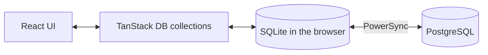

# Oriel

[](LICENSE)

Author: **Ákos Kappel**

One calm place for the everyday things you don't want to forget: notes, shopping lists, tasks and quick thoughts, alone or shared with the people you live with. Built mobile-first and offline-first, so it opens instantly and keeps working without a connection.

**Status:** early development. Capture, editing and organization of notes, lists and tasks work fully offline: data lives in a local SQLite database and the app installs as a PWA. Sign-in and sync come next.

## Principles

- **Fast capture:** adding something takes seconds, without forms.
- **Offline-first:** data lives on the device first and syncs when a connection is available.
- **Live collaboration:** shared lists update on every member's device.
- **Private by default:** you see only what you own or what was shared with you.

## Quick capture

The capture field sits at the bottom of the screen. Pick Note, List or Task, type, and press Enter; Shift+Enter starts a new line, and `/` focuses the field on desktop.

- The first line is the title. Further lines become the note body, the task details or the list entries (bullets and `[ ]` are removed).
- A list fits on one line: `Groceries: milk, eggs, bread`.
- A long pasted paragraph becomes a note with a short title and the full text kept.

## Organizing

- **Home:** pinned items first, then open items by priority and date, completed tasks folded away. Filter by notes, lists or tasks; the filter is part of the URL.
- **Detail:** edit the title and text (saved as you type), complete tasks, set a priority (none, low, medium, high), pin, or delete with Undo.
- **Lists:** check, rename, remove (or empty the text) and add entries; pasting several lines adds one entry per line. Checked entries move to the bottom, and "Clear checked" removes them with Undo.

## Offline and installable

- A service worker (`scripts/service-worker.js`, emitted as `sw.js` with the build) precaches the app, so it opens and works with no connection after the first visit. New versions are offered with a Reload button, never forced mid-edit.
- Installable as a PWA, with shortcuts for a new note, list or task, and a share target: sharing a link or text from another app on Android creates a note.
- The browser is asked to keep the database (persistent storage) after the first save.

## Accounts

No account is needed: everything works on the device. Creating an account (email and password, with Better Auth) gives you a personal space on the server, and everything you made before signing up moves into it, so nothing is lost. Signing out removes the data from the device, so the next person to use it starts clean.

## Tech stack

- [TanStack Start](https://tanstack.com/start) (React 19, file-based routing) on Vite and Nitro
- TypeScript
- React Aria Components for accessible controls, Tailwind CSS v4, Newsreader and Instrument Sans (self-hosted), Lucide icons
- [TanStack DB](https://tanstack.com/db) for reactive client collections and optimistic writes
- [PowerSync](https://www.powersync.com) Web SDK with SQLite (WASM) as the local database
- Zod for validation
- PostgreSQL 18 with Drizzle ORM, Better Auth for accounts
- Planned: syncing the local database with PostgreSQL through PowerSync
- Biome, Vitest, GitHub Actions

## How it works



The UI only talks to local data. PowerSync uploads local changes when the device is online and streams changes from other devices back. The server decides who may see and change what.

## Getting started

Requires Node.js 24 and Docker (for the PostgreSQL database).

```bash
npm install
cp .env.example .env    # then set DB_PASSWORD, the same password in DATABASE_URL, and BETTER_AUTH_SECRET
docker compose up -d db
npm run db:migrate
npm run dev
```

The app runs at http://localhost:3000. Without the database it still works fully on the device; only accounts need it.

## Scripts

| Command               | What it does                           |
| --------------------- | -------------------------------------- |
| `npm run dev`         | Start the dev server                   |
| `npm run build`       | Build for production into `.output/`   |
| `npm start`           | Run the production build               |
| `npm run check`       | Lint and format check (Biome)          |
| `npm run check:fix`   | Fix lint and formatting                |
| `npm run typecheck`   | Type-check the project                 |
| `npm test`            | Run the unit tests                     |
| `npm run db:generate` | Create a migration from schema changes |
| `npm run db:migrate`  | Apply migrations                       |

## License

[MIT](LICENSE)
