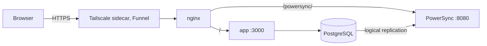

# Production deployment

The live app runs from its own folder, not from this repository, so the development checkout
can change branches and reset its database without touching it.

|                 | Development                           | Production                                                                    |
| --------------- | ------------------------------------- | ----------------------------------------------------------------------------- |
| Folder          | `~/projects/oriel`                    | `~/deploy/oriel`                                                              |
| Compose project | `oriel`                               | `oriel-prod`                                                                  |
| App             | `npm run dev` on port 3000            | image from GHCR behind nginx on `127.0.0.1:8087`, public via Tailscale Funnel |
| Sync service    | `oriel-powersync` on `127.0.0.1:8086` | `oriel-prod-powersync`, reached through nginx at `/powersync/`                |
| Database        | `oriel-db` on `127.0.0.1:5437`        | `oriel-prod-db`, no host port                                                 |



Browsers reach the app and the sync service on one origin (`POWERSYNC_URL` is the app's URL plus
`/powersync`), so there is no second hostname, no CORS and no extra Funnel port. On start, the
`migrate` container applies migrations, then `powersync-setup` creates PowerSync's roles and
storage database (`powersync/roles.sql`, safe to repeat), and only then do the app and the sync
service start.

## First setup

1. Nothing to do for the image: `ghcr.io/akoskappel/oriel` is public (checked 2026-10-28 with
   an anonymous pull token), so the server pulls it without logging in.
2. Create the folders and copy the files, from the repository root:

   ```bash
   mkdir -p ~/deploy/oriel/{tailscale,maintenance,nginx,powersync} ~/logs/oriel ~/backups/oriel
   cp deploy/compose.yaml deploy/compose.tailscale.yaml deploy/deploy.sh deploy/restore-test.sh scripts/smoke.ts ~/deploy/oriel/
   cp deploy/tailscale/serve.json ~/deploy/oriel/tailscale/
   cp deploy/maintenance/index.html ~/deploy/oriel/maintenance/
   cp deploy/nginx/default.conf ~/deploy/oriel/nginx/
   cp powersync/service.yaml powersync/sync-config.yaml ~/deploy/oriel/powersync/
   cp scripts/powersync-roles.sql ~/deploy/oriel/powersync/roles.sql
   cp deploy/.env.example ~/deploy/oriel/.env
   ```

3. Fill in `~/deploy/oriel/.env` with fresh secrets (the comments say how to make each),
   `IMAGE_TAG` from the latest green CI run on `main`, a production `RESEND_API_KEY` and, for morning reminders, a VAPID key pair (`npx web-push generate-vapid-keys`). Put
   the Tailscale auth key into `tailscale/ts.env` (`TS_AUTHKEY=...`, the same reusable key as
   the other apps). `chmod 600` both files.
4. Start it: `cd ~/deploy/oriel && docker compose up -d`.
5. Check: `node smoke.ts https://oriel.tailb52c43.ts.net`, then sign up on a phone over mobile
   data and see a note arrive on a second device.

## Deploy a new version

After CI on `main` is green, in `~/deploy/oriel`:

```bash
./deploy.sh
```

It finds the commit of the latest green CI run (`gh`), checks that the image exists, dumps the
database next to the nightly backups, sets `IMAGE_TAG`, pulls, starts (migrations and the
PowerSync roles first), waits for the health check and runs the smoke test (`smoke.ts`: health,
security headers, the sync token endpoint, the sync service through nginx, the 404 page). It
creates nothing. Each deploy is appended to `deploys.log`. `./deploy.sh sha-1234567` deploys a
given tag, which is also how to go back; migrations only move forward, so go back only to a
version with the same schema, or restore the dump the script made.

When a file in this `deploy/` folder, `powersync/` or `scripts/powersync-roles.sql` changed,
copy it to the deploy folder before running the script. After a change to `nginx/default.conf`:
`docker compose exec nginx nginx -s reload`. After a change to the sync config:
`docker compose restart powersync`.

After the first deploy, check `docker compose logs app` for Better Auth's warning that it "could
not determine a client IP": without the visitor's address from the sidecar, rate limits fall back
to one bucket shared by everyone.

## Maintenance mode

For work that needs the app stopped (a restore, a long migration), switch on the maintenance
page; every path, `/powersync/` and `/api/health` included, then answers 503 with "Back in a few
minutes", and requests from open apps get a short 503 they retry. Open apps keep working offline
and upload their changes once it is off.

```bash
touch maintenance/on   # on, no reload needed
rm maintenance/on      # off
```

The same page shows by itself while the app restarts during a deploy.

## Backups

The `backup` service writes `oriel-YYYY-MM-DD.dump` of the app database to `BACKUP_DIR` at start
and then every 24 hours, keeping 14 days. PowerSync's storage database is not backed up: after a
restore the service replicates from the app database again, and devices resync. The dumps protect
against mistakes and bad migrations, not against losing this machine: copy the folder elsewhere.

`./restore-test.sh` restores the newest dump into a throwaway container (no network) and checks
that users, spaces, items and migrations are there. Run it once a month.

Restore into production (maintenance on first, then off):

```bash
docker compose stop app powersync
docker compose exec -T db pg_restore -U oriel -d oriel --clean --if-exists <~/backups/oriel/oriel-YYYY-MM-DD.dump
docker compose up -d
```

## Checked before going live

On 2026-10-28 the whole stack ran from a copy of this folder on the staging port, without the
sidecar: everything started in order, the smoke test passed, two browser sessions on one account
synced through nginx in both directions (a new note arrived on the other in under a second),
maintenance mode answered every path, the backup wrote its first dump, and the restore test
passed on it.
